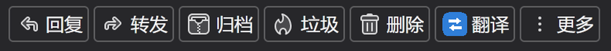
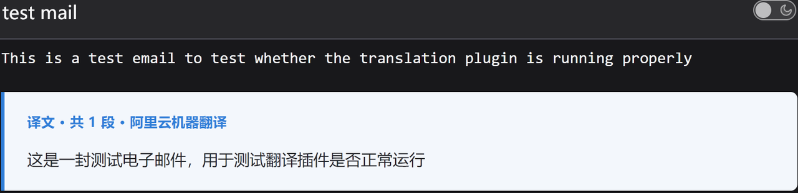
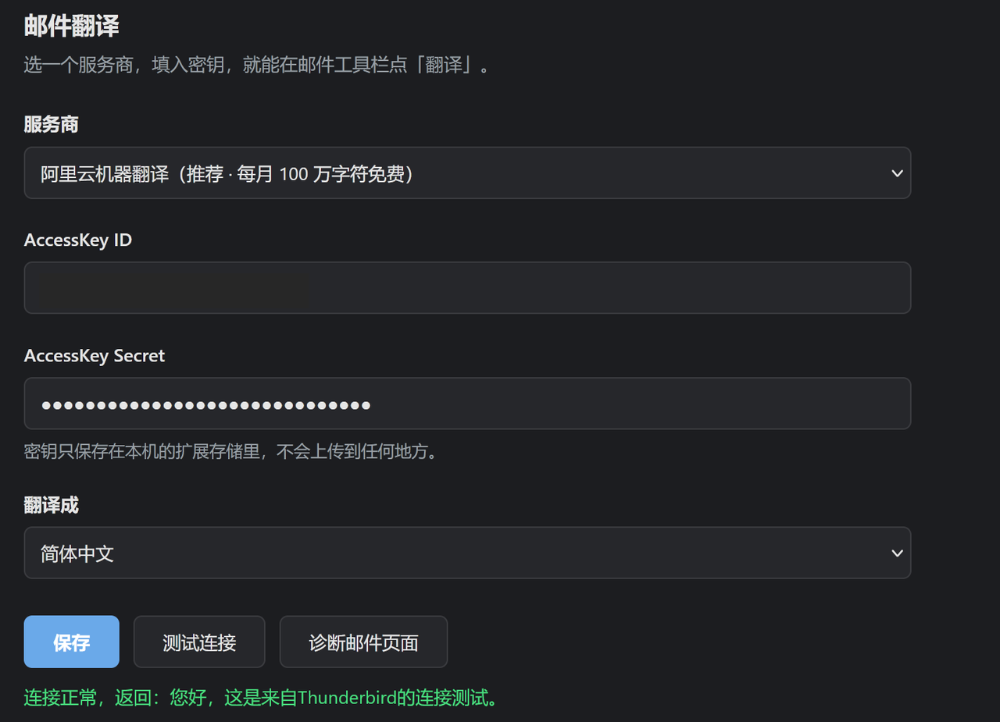

# 邮件翻译 · Thunderbird Mail Translate

> 一个给 Thunderbird 用的邮件翻译扩展，把外文邮件正文翻成中文，直接显示在邮件下方。
> 面向国内用户：不需要国际信用卡，用阿里云或腾讯云的机器翻译，每月有免费额度。

[English summary](#english-summary) · [安装](#安装) · [配置](#配置) · [常见问题](#常见问题)

---

## 效果

邮件工具栏上多一个「翻译」按钮：



点一下，译文出现在正文下方，原文原样保留：



配置很简单，填两个密钥、点「测试连接」：



## 为什么做这个

Thunderbird 没有内置邮件翻译。装现成的翻译扩展，遇到的问题通常是：

- 走 Google 翻译，国内连不上
- 要自己填 DeepL / Azure 的 API Key，注册要国际信用卡
- 只能划词翻译，不能整封邮件翻
- 翻译结果直接替换掉邮件内容，看完想对原文就没了

这个扩展针对这几点做：**整封翻译、译文独立成块不覆盖原文、用国内可注册的免费 API、密钥只存本地。**

## 特性

- **整封翻译**：不是划词，一次翻完整个正文
- **原文保留**：译文追加在邮件末尾，浅蓝区块，可以边看边对
- **国内可用**：阿里云机器翻译（每月 100 万字符免费）/ 腾讯云 TMT
- **零后端**：扩展直连翻译 API，没有中转服务器，密钥只存在本机
- **长邮件自动分段**：按段落切分，4500 字符一段，串行请求避开 QPS 限制
- **双入口**：邮件工具栏的「翻译」按钮，或右键菜单
- **失败可见**：错误写进邮件页面；页面写不进去就弹通知 + 打开选项页，不会静默失败

## 支持的服务商

| | 阿里云机器翻译 | 腾讯云机器翻译 |
|---|---|---|
| 免费额度 | **100 万字符/月** | 2026-10 起停止发放免费包 |
| 生命周期 | 长期 | 2027-10-01 接口关闭 |
| 注册门槛 | 淘宝/支付宝登录 + 实名 | 微信登录 + 实名 |
| 单次上限 | 5000 字符 | 5000 字符 |
| 计费 | 50 元/百万字符 | 按量 |

推荐阿里云。腾讯云自 2026-10-01 起 QPS 每月递减 5%（2027-02 起每月 10%），2027-10-01 起 QPS 归零、接口彻底不可用，只适合过渡。

## 安装

### 从文件安装

1. 下载 `mail-translate-<version>.xpi`
2. Thunderbird → ≡ → 附加组件和主题 → 右上角齿轮 ⚙️ → **从文件安装附加组件**
3. 选择 xpi，确认添加
4. **完全退出 Thunderbird**（托盘图标右键退出，或任务管理器结束所有 `thunderbird.exe`），再重新打开

> 第 4 步不能省。注入到邮件页面的脚本，需要 Thunderbird 重启后才会加载。

Thunderbird 允许安装未签名扩展（`MOZ_REQUIRE_SIGNING=false`），不需要改 `about:config`。

### 自己构建

```bash
python build.py          # 产物在 dist/
```

## 配置

### 阿里云（推荐）

1. <https://mt.console.aliyun.com> 用淘宝/支付宝账号登录
2. 完成实名认证（「支付宝授权」扫码最快）
3. 点「开通服务」，通用版开通即享每月 100 万字符免费额度
4. <https://ram.console.aliyun.com/manage/ak> 创建 AccessKey，记下 ID 和 Secret（Secret 只显示一次）
5. Thunderbird → 附加组件 → 邮件翻译 → 选项，填入，点「测试连接」

### 腾讯云

1. <https://console.cloud.tencent.com/cam/capi> 微信扫码登录，实名后「API 密钥管理」新建密钥
2. <https://console.cloud.tencent.com/tmt> 点「开通服务」，否则会报 `FailedOperation.UserNotRegistered`
3. 填进选项里测试

## 使用

点开一封外文邮件，点击邮件工具栏右侧的「翻译」按钮（或右键 → 翻译此邮件正文）。

长邮件会显示进度，译文出现在正文下方：

```
译文 · 共 3 段 · 阿里云机器翻译
────────────────────────────
（译文内容）
```

如果扩展无法往邮件页面注入脚本（极少数情况），会自动退回到另一种方式：读取邮件原始 MIME 内容，翻译后在新标签页展示译文。功能不受影响，只是不在原位显示。

## 技术说明

### 注入方式

`manifest.json` 里**不使用** `message_display_scripts`（在 Thunderbird 158 上实测不生效）。改为三重保障：

1. 启动时 `browser.messageDisplayScripts.register()` 运行时注册
2. 遍历已打开的标签页，`browser.tabs.executeScript()` 补注入
3. 点击按钮时若仍无响应，再注入一次并重试

需要 `messagesModify` 权限才能往邮件页面注入脚本。

### 阿里云签名（RPC 风格，HMAC-SHA1）

```
canonical    = 按参数名排序后 percentEncode(k)=percentEncode(v) 用 & 连接
stringToSign = "GET&" + percentEncode("/") + "&" + percentEncode(canonical)
signature    = Base64(HMAC-SHA1(secret + "&", stringToSign))
```

`percentEncode` 遵循 RFC3986：只有 `A-Za-z0-9-._~` 不编码，其余全部 `%XY`。

**踩过的坑**：JS 的 `encodeURIComponent` 不会编码 `! ' ( ) *`，必须手动补成 `%21 %27 %28 %29 %2A`，少一个签名就失败。

已用阿里云文档的公开示例核对：

```
AccessKeyId=testid / Secret=testsecret
Signature = OLeaidS1JvxuMvnyHOwuJ+uX5qY=   ✓ 与官方一致
```

### 腾讯云签名（TC3-HMAC-SHA256）

canonicalHeaders 用 `content-type / host / x-tc-action`（action 值转小写），
`join('\n')` 产生的双空行是规范要求，不是笔误。

已用官方示例核对 payload 哈希与 CanonicalRequest 哈希，逐字节一致。

### 代码结构

```
manifest.json     MV2；message_display_action 提供工具栏按钮
background.js     菜单/按钮事件、两家签名、分段串行请求、降级路径
content.js        注入邮件页面；提取正文 innerText、插入译文块
options.html/js   服务商切换与密钥配置，内置诊断按钮
result.html/js    降级模式下展示译文的独立页面
icons/            32/48/64 图标
build.py          打包脚本
```

## 常见问题

**点了按钮没反应 / 按钮显示 `!`**

打开「选项 → 诊断邮件页面」，它会遍历所有标签页，告诉你注入脚本到底在不在。
如果显示没有响应，完全退出 Thunderbird 再打开（关窗口不算退出）。

**提示密钥错误**

阿里云 `SignatureDoesNotMatch` 基本都是 AccessKeySecret 复制错了或末尾多了空格。
腾讯云 `AuthFailure.SignatureFailure` 同理。

**提示未开通服务**

阿里云 10009 / 腾讯云 `FailedOperation.UserNotRegistered`，去各自控制台点「开通服务」。

**翻译出来是空的**

邮件正文可能全是图片。本扩展只翻译纯文本，不做 OCR。

## 隐私

- **没有自建服务器**。本扩展只联系你在选项页里配置的那个翻译接口
- 邮件正文**仅在你点击「翻译」时**发送给你选择的服务商，不发往其他地方
- API 密钥与配置只存放在本机 `storage.local`，不上传、不同步
- 无遥测、无统计、无崩溃上报，不读取账号密码、联系人、日历、附件

完整政策（含英文章节）：[docs/PRIVACY_POLICY.md](docs/PRIVACY_POLICY.md)

## 已知限制

- 只翻译纯文本，不保留表格、加粗、图片排版
- 引用内容（上一封来信）也会被翻译，暂未做过滤
- 密钥明文存放在扩展 `storage.local`，仅限本机，公用电脑请谨慎
- 不支持 Outlook / Exchange 的 Graph 协议（只走标准 IMAP 邮件内容）

## 同类项目

GitHub 上 Thunderbird 翻译类扩展普遍很小（star 数多在个位数），主要区别在翻译后端：

| 项目 | 后端 | 备注 |
|---|---|---|
| [Web Translate](https://addons.thunderbird.net/thunderbird/addon/web_translate/) | Google/微软/DeepL/百度网页端点 | 用户最多，但走网页端点，易被限流 |
| [Thunderbird Translate](https://github.com/sully-vian/thunderbird-translate) | Gemini API | 需要 Google AI Key |
| [thunderbird-translator](https://github.com/zoott28354/thunderbird-translator) | Ollama / Google / LibreTranslate | 支持本地模型 |
| [thunderbird-translate](https://github.com/willlllliams/thunderbird-translate) | 20+ AI 服务商 | 功能丰富，偏 AI 场景 |
| **本项目** | **阿里云 / 腾讯云** | 面向国内免费额度，整封翻译 + 原文保留 |

本项目的注入方式参考了 [Thunderbird Translate](https://github.com/sully-vian/thunderbird-translate) 的实现（运行时注册 + 补注入），在此致谢。

## English summary

A Thunderbird extension that translates the whole message body into Chinese and appends the translation below the original text. It targets users in mainland China by using **Alibaba Cloud Machine Translation** (1M characters/month free) or **Tencent Cloud TMT**, neither of which requires an international credit card. API keys are stored locally only; there is no backend server.

## License

MIT
